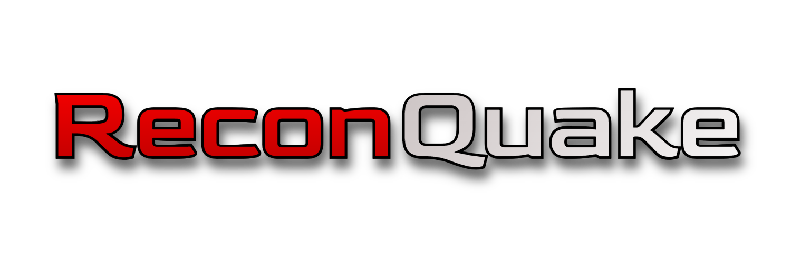

# ReconQuake

ReconQuake is a fork of GlobalQuake. ReconQuake includes special features that were not finalized with the last full public release of GlobalQuake.

ReconQuake includes special customization features with the program that the v0.11 GlobalQuake did not originally have.


## Screenshot


Playground mode recieves an upgrade with expanded earthquake customization, including date/time customization, and enhanced earthquake simulation.
## Installation

Compiling the project requires Maven: https://maven.apache.org/download.cgi

Running the program requires Java: https://www.java.com/en/download/manual.jsp.

Download the source code to a directory of your choice.
In a terminal or command prompt, change the directory to where you extracted your files.

Once done, run this command in the terminal in your local directory:
```
mvn clean package
```

Maven will then compile the project into a .jar file, which should be extracted to the local directory or a folder within the directory (*The prompt will then inform you of where the .jar has been extracted.*)

Simply double-click the .jar file on your file explorer, and the application should run.
